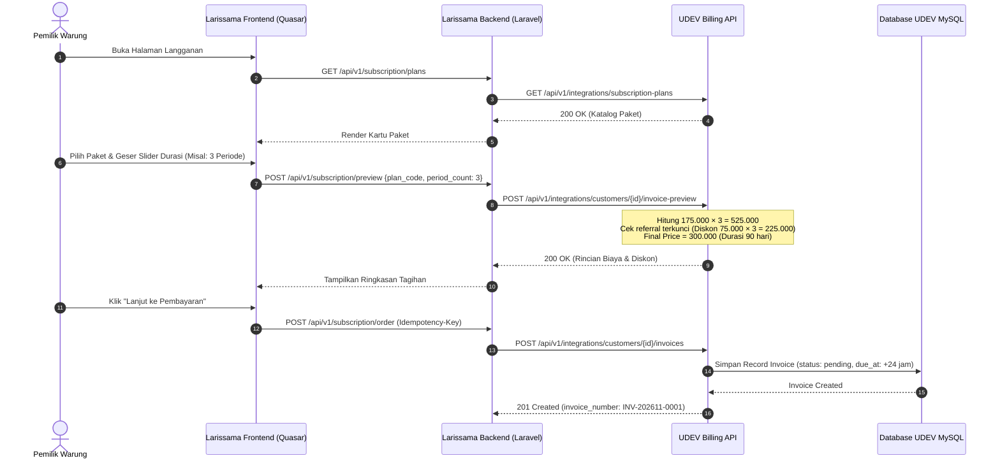
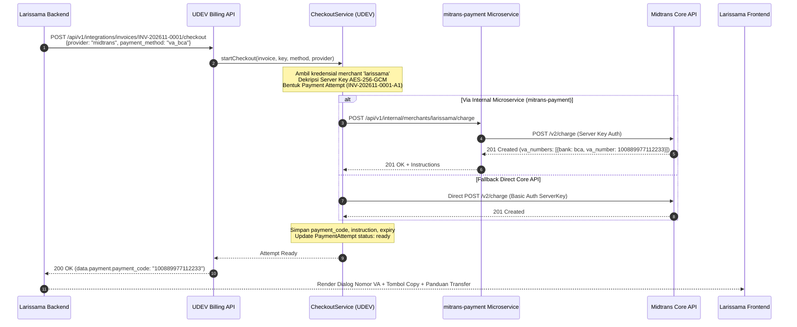
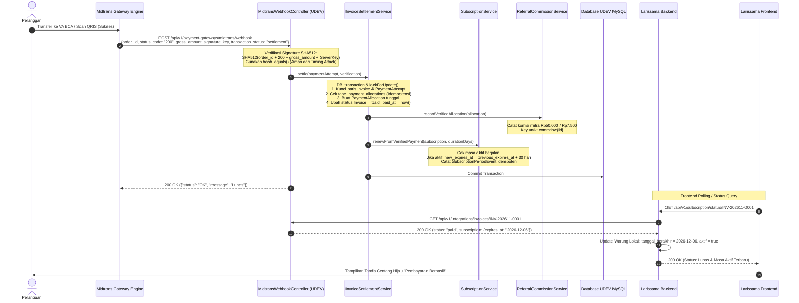
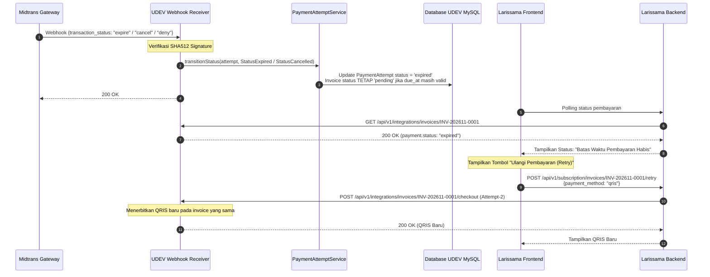
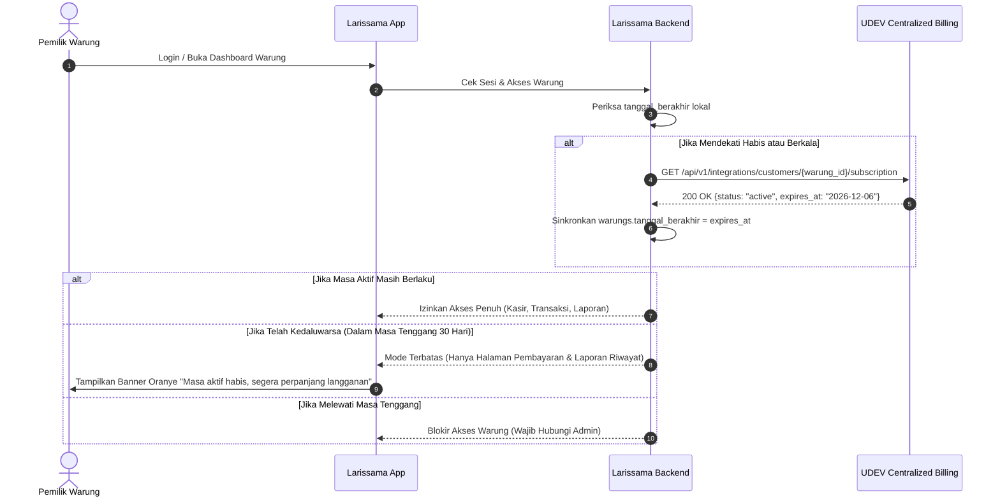

# DIAGRAM ALUR PEMBAYARAN & SINKRONISASI
## UDEV CENTRALIZED BILLING ↔ LARISSAMA (MIDTRANS)

---

## 1. Diagram A: Penerbitan Invoice (Create Invoice Flow)

Menjelaskan bagaimana pelanggan di frontend Larissama memilih paket, meminta preview harga/diskon, dan menerbitkan invoice penagihan resmi berstatus `pending` di UDEV.

---

## 2. Diagram B: Inisiasi Checkout Midtrans (Checkout Flow)

Menjelaskan proses UDEV memanggil microservice `mitrans-payment` dan Midtrans Core API hingga mengembalikan instruksi bayar (QRIS / Nomor VA) ke pelanggan.

---

## 3. Diagram C: Penyelesaian Pembayaran & Settlement (Settlement Flow)

Menjelaskan alur webhook notifikasi Midtrans saat pelanggan berhasil membayar, verifikasi signature, settlement idempoten, dan penambahan masa aktif.

---

## 4. Diagram D: Pembayaran Gagal atau Kedaluwarsa (Failure & Expiry Flow)

Menjelaskan penanganan kondisi saat pelanggan tidak membayar hingga batas waktu habis atau transaksi ditolak.

---

## 5. Diagram E: Sinkronisasi Akses & Masa Aktif Warung (Access Check Flow)

Menjelaskan bagaimana Larissama memastikan warung yang beroperasi memiliki paket aktif dari UDEV.

